<!-- header:start -->
<div align="center">



<a href="#-quick-start"></a>

<a href="LICENSE"></a>

<a href="https://github.com/ajendras/php-csp-audit/stargazers"></a>
<a href="https://github.com/ajendras/php-csp-audit/actions/workflows/ci.yml"></a>

<a href="CONTRIBUTING.md"></a>

**Scans a PHP project directory and emits a strict CSP header for .htaccess or server config.**

[✨ Features](#-features) • [⚡ Quick start](#-quick-start) • [🧰 Usage](#-usage) • [🧩 Architecture](#-architecture) • [📍 Roadmap](#-roadmap) • [🤝 Contributing](#-contributing)

</div>
<!-- header:end -->

## ✨ Why PHP CSP Audit?

Writing accurate CSP headers by hand is error-prone and most developers default to unsafe rules that leave their applications exposed. PHP CSP Audit closes the gap by recursively scanning your PHP project, detecting real resource usage through regex analysis, and emitting a strict, ready-to-paste CSP header.

- Automatically discovers external scripts, stylesheets, images, fonts and connection endpoints
- Produces a tight baseline policy with smart defaults (`'self'`, `'unsafe-inline'` for styles, `data:` for images)
- Zero-configuration, single-file PHP 8+ script — perfect for CI pipelines and pre-deploy checks
- Helps prevent XSS by showing you exactly what your application actually loads

## 🎬 Demo

<p align="center"></p>

## 🚀 Features

<table>
<tr>
<td align="center">🔍<br><b>Recursive scan</b><br>Walks directories and parses HTML, PHP, JS and CSS files using SPL iterators</td>
<td align="center">📡<br><b>Resource detection</b><br>Extracts script src, stylesheet links, img src and url() fonts via preg_match_all</td>
<td align="center">🏗️<br><b>CSP builder</b><br>Outputs default-src 'self' policy with discovered sources appended</td>
</tr>
<tr>
<td align="center">📦<br><b>Zero deps</b><br>Single-file PHP 8+ script that runs anywhere with zero installation</td>
<td align="center">⚡<br><b>Fast &amp; CI-ready</b><br>Completes in seconds and prints a header you can paste directly into .htaccess</td>
<td align="center">🎨<br><b>Smart defaults</b><br>Always includes 'unsafe-inline' for styles and data: for images</td>
</tr>
</table>

## 📦 Installation

Requires PHP 8+ (no extensions beyond SPL and PCRE).

```bash
curl -O https://raw.githubusercontent.com/ajendras/php-csp-audit/main/csp-audit.php
chmod +x csp-audit.php
php -l csp-audit.php
```

## ⚡ Quick start

```bash
./csp-audit.php .
```

The script scans the current directory (or the path you provide) and prints a complete CSP header.

## 🧰 Usage

Scan the current project and see the generated policy:

```bash
./csp-audit.php
```

Target a specific directory:

```bash
./csp-audit.php /var/www/my-app
```

Save the header for use in `.htaccess` or server config:

```bash
./csp-audit.php /path/to/project > csp-header.txt
```

<details><summary>Using in a deployment script</summary>

```bash
#!/bin/bash
echo "Header set Content-Security-Policy \"$(./csp-audit.php /var/www/app | tr -d '\n')\"" \
  >> /etc/apache2/conf-available/csp.conf
```
</details>

<details><summary>Integrating into CI (GitHub Actions example)</summary>

```yaml
- name: Generate CSP
  run: ./csp-audit.php . > $GITHUB_WORKSPACE/csp.txt
```
</details>

## 🧩 Architecture

```mermaid
flowchart TD
    CLI[$argv[1] or getcwd()] --> RII[RecursiveIteratorIterator + RecursiveDirectoryIterator]
    RII --> Filter[Filter by extension: html, htm, php, js, css]
    Filter --> Read[file_get_contents]
    Read --> Regex[preg_match_all for script, link[rel=stylesheet], img, url()]
    Regex --> Sources[Aggregate into $sources array]
    Sources --> Builder[Build $csp string with fixed defaults]
    Builder --> Echo[echo $csp]
```

The entire tool lives in a single self-contained `csp-audit.php` file. It uses PHP’s built-in filesystem and regex functions to discover resources, then constructs a CSP header that balances security with functionality using opinionated but practical defaults.

## 📁 Project structure

```text
.
├── csp-audit.php                 # Main CLI script — does everything
├── LICENSE
├── README.md
├── CONTRIBUTING.md
├── CODE_OF_CONDUCT.md
├── SECURITY.md
└── .github/
    ├── ISSUE_TEMPLATE/
    │   ├── bug_report.md
    │   └── feature_request.md
    └── PULL_REQUEST_TEMPLATE.md
```

## 🧪 Testing

```bash
php -l csp-audit.php
```

This syntax-checks the script. Because the tool is a single focused file, testing consists of running it against sample projects containing typical HTML/PHP/JS/CSS patterns to verify the generated CSP matches expected resource hosts.

## 📍 Roadmap
<!-- roadmap:start -->
- [ ] Add PHPUnit tests that assert generated CSP for fixture directories
- [ ] Detect inline <script> and <style> tags and conditionally add 'unsafe-inline'
- [ ] Add --json flag that outputs discovered resources instead of CSP string
- [ ] Support --nonce flag that prints a random nonce and example meta tags
- [ ] Extract hostnames only (instead of full paths) for external resources
- [ ] Add --ignore flag to skip directories like node_modules, vendor, dist
- [ ] Improve regexes to avoid matching inside comments or strings
- [ ] Add support for worker-src, frame-ancestors and object-src directives
- [ ] Write a proper man-page style help output when no argument is given
- [ ] Add example GitHub Action that runs the scanner on every push
- [ ] Update README with real before/after CSP examples and security impact
- [ ] Add connect-src detection by scanning for fetch, XMLHttpRequest and EventSource patterns

> 🤖 This roadmap is worked through continuously — ideas and PRs welcome!
<!-- roadmap:end -->

## 🤝 Contributing

Thanks for considering a contribution! Whether it’s a bug report, feature idea, documentation tweak or code change, every bit helps.

Read our [CONTRIBUTING.md](https://github.com/ajendras/php-csp-audit/blob/main/CONTRIBUTING.md) and [CODE_OF_CONDUCT.md](https://github.com/ajendras/php-csp-audit/blob/main/CODE_OF_CONDUCT.md). New contributors are especially welcome — check out the **good first issue** label on the [issue tracker](https://github.com/ajendras/php-csp-audit/issues).

## 📄 License

[MIT License](LICENSE) — see the [LICENSE](https://github.com/ajendras/php-csp-audit/blob/main/LICENSE) file for details.

<!-- footer:start -->
<div align="center">

### ⭐ Star history

<a href="https://star-history.com/#ajendras/php-csp-audit&Date"></a>

If **PHP CSP Audit** saves you time, a ⭐ helps others find it.

Made with ❤️ by [Ajendra](https://ajendra.info)


</div>
<!-- footer:end -->
